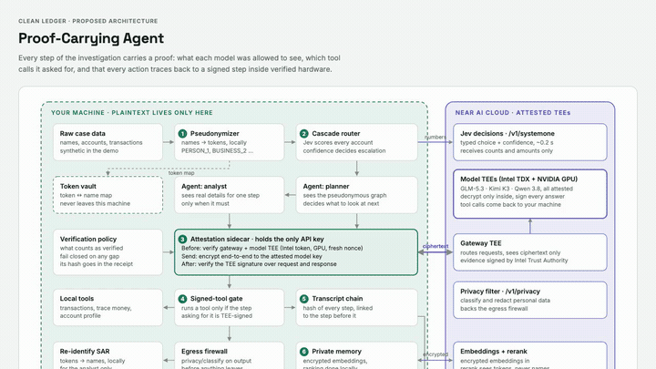
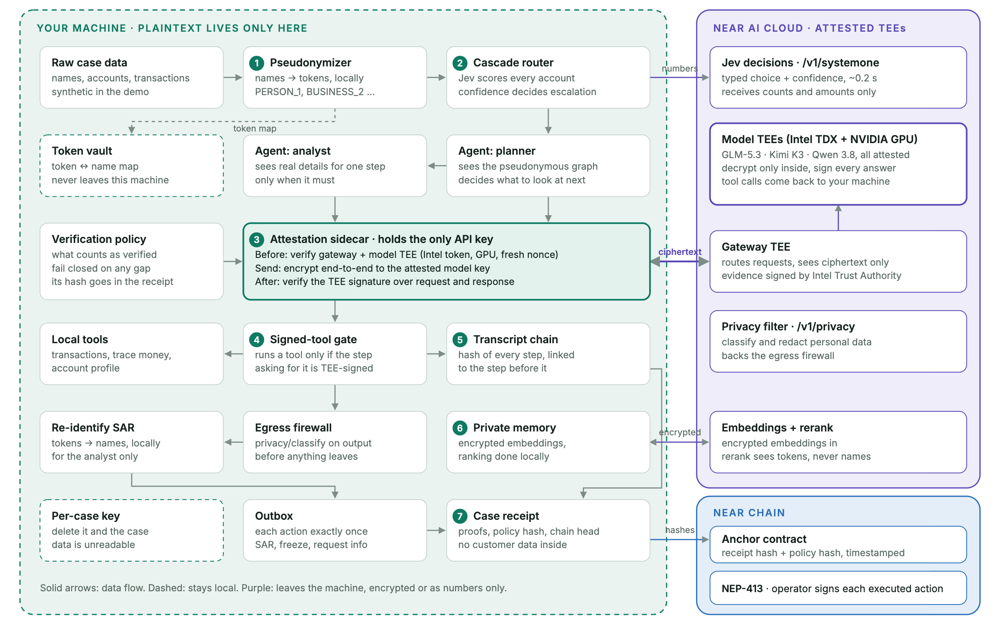
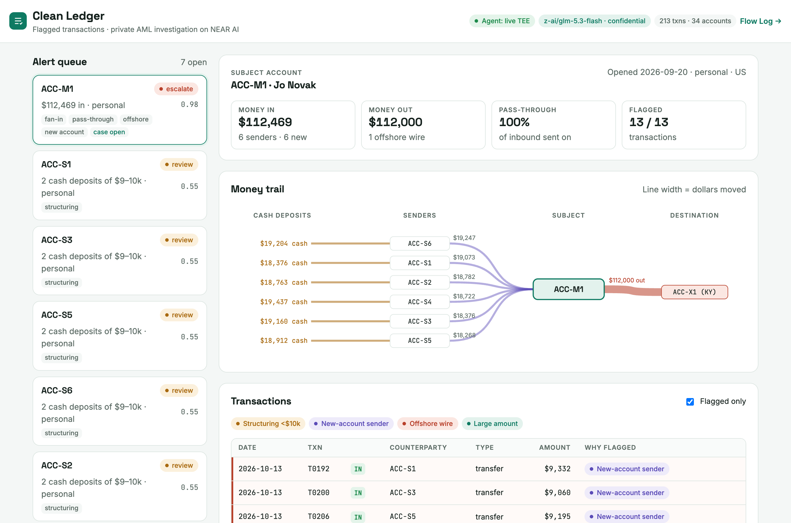
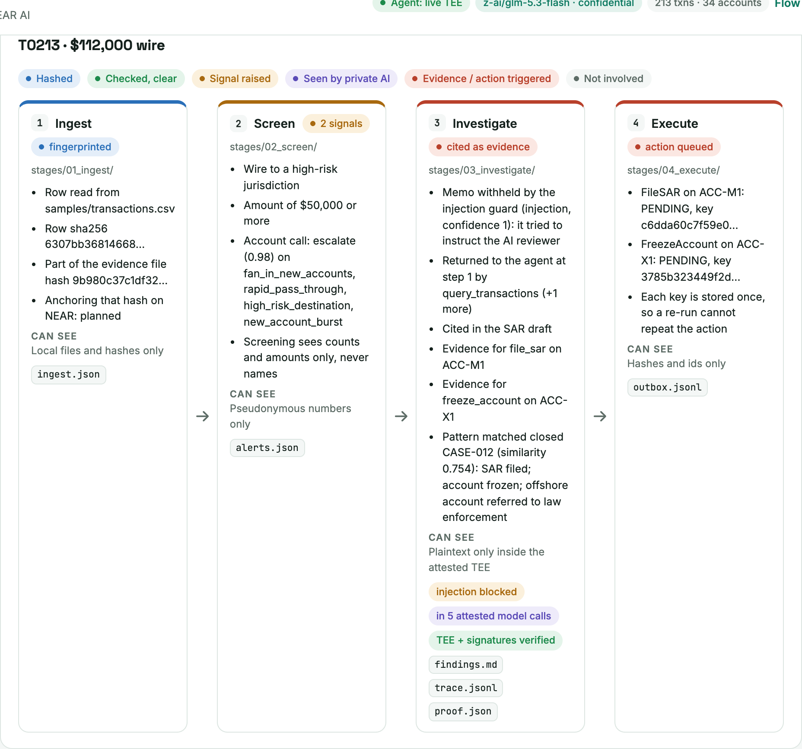
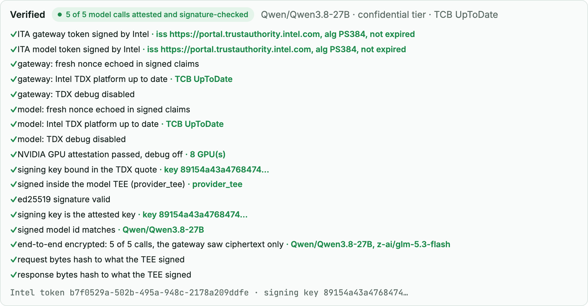
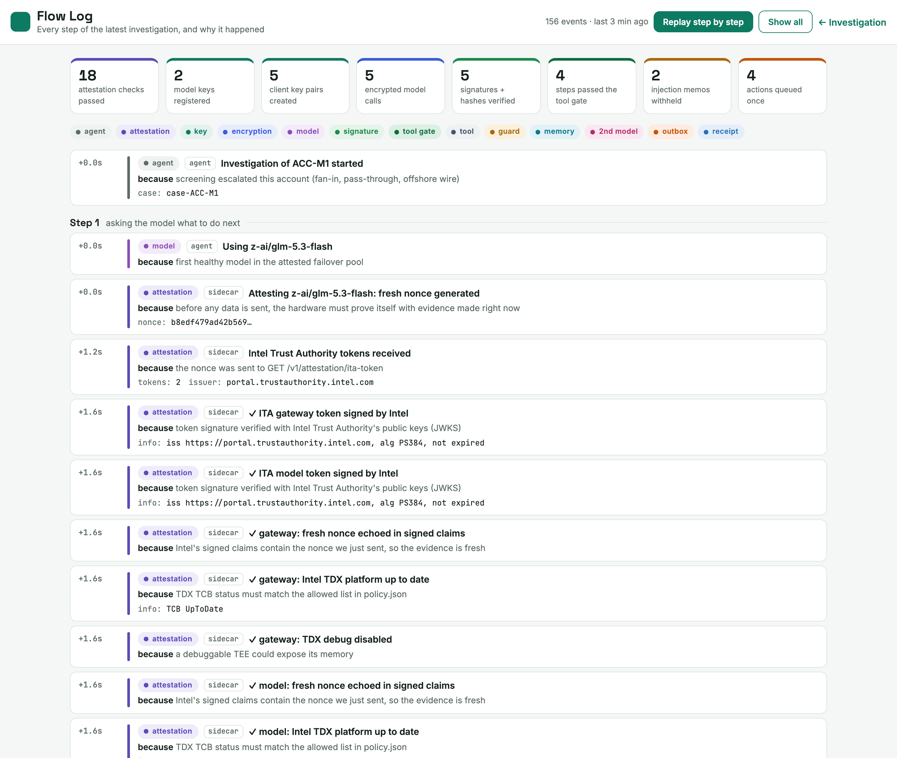
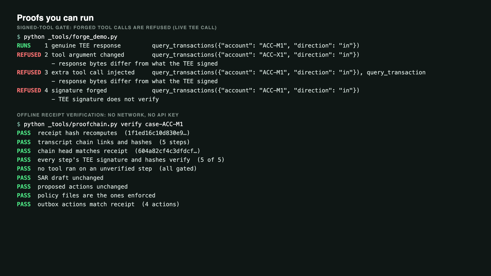

# Clean Ledger

An agentic anti-money-laundering investigator that runs on NEAR AI Cloud's confidential compute, where every step carries a proof.

A bank's flagged accounts are screened, then an AI agent traces the money using local tools, drafts a suspicious activity report (SAR) and proposes actions. Customer data is encrypted end to end to an attested model inside a TEE, every model response is signature-checked before any tool may run, a second attested model must agree before an account is frozen, and the whole investigation is sealed in a receipt an examiner can re-verify offline.

Built at the NEAR Hackathon (Build City NYC, Nov 2026). Tracks: Privacy & Private AI, AI Security & Defense.

## Demo

[](media/clean-ledger-demo.mp4)

The animation is a sped-up preview. Open either MP4 for the full walkthrough with narration:

- **[Watch the demo (1:48)](media/clean-ledger-demo.mp4)** — architecture, investigation console, transaction flow, verification and terminal proofs.
- **[Watch the extended demo (2:35)](media/clean-ledger-demo-extended.mp4)** — adds the Flow Log replay, showing attestation, encryption, signature checks and the signed-tool gate step by step.

Both videos, the preview and all eight screenshots are together in **[media/](media/)**. The recordings use the synthetic sample ledger.

## Architecture



[Full architecture page](media/architecture-full.png) · [Security layers](media/security-layers.png) · [Diagram source](docs/architecture.html)

The diagram includes planned components, including the NEAR anchor and NEP-413 signing. See [What is tested, and what is not](#what-is-tested-and-what-is-not) for the current implementation's scope.

## Screenshots

| Investigation console | Transaction T0213: injection attempt |
|---|---|
| [](media/app-overview.png) | [](media/transaction-flow-T0213.png) |

| Verified panel | Flow Log |
|---|---|
| [](media/verified-panel.png) | [](media/flow-log.png) |



## Why it is different

Most private-AI apps send one prompt to one TEE model and show an attestation badge. Clean Ledger proves each step of a multi-step agent:

| Layer | What it stops | NEAR API |
|---|---|---|
| Attestation sidecar | fake or outdated hardware; the gateway swapping models | `/v1/attestation/ita-token`, `/v1/attestation/report`, `x-no-aliasing` |
| End-to-end encryption | the gateway or network reading customer data | E2EE chat completions (attested model key) |
| Signed-tool gate | a forged or altered response triggering a tool | `/v1/signature/{chat_id}` |
| Injection guard | a transaction memo hijacking the agent | `/v1/systemone` (Jev) |
| Privacy gate | personal data reaching models that are not verified TEEs | `/v1/privacy/classify` |
| Past-case memory | the agent missing precedent | `/v1/embeddings`, `/v1/rerank` |
| Two-model rule | one model's mistake freezing a customer's account | a second attested model, another vendor |
| Attested failover | outages, without falling back to a weaker model | 3 attested TEE models with E2EE |
| Transcript chain + receipt | evidence being edited afterwards | local hashes (NEAR anchor: next step) |

Architecture diagram: [image](media/architecture-diagram.png) · [HTML source](docs/architecture.html).

## How a case runs

The pipeline is an ICM workspace: each stage is a folder with a `CONTEXT.md` contract and an `output/` folder (see `AGENTS.md`).

1. `01_ingest`: load transactions, hash the evidence file.
2. `02_screen`: score every account from numbers only; escalate suspicious ones.
3. `03_investigate`: the agent loop. Each step: attest the model, encrypt the conversation to its key, call it through the sidecar, verify the TEE signature over the exact bytes, decrypt, then run the requested read-only tools. Tool results pass the injection guard first. Freeze proposals go to a second attested model.
4. `04_execute`: the outbox writes each approved action once (idempotency keys), then the receipt is sealed.

## Run it

Requires Python 3.12+ and a NEAR AI Cloud API key.

```bash
python3 -m venv .venv && .venv/bin/pip install -r requirements.txt
cp .env.example .env            # put your key after NEARAI_API_KEY= (never commit .env)
./run.sh                        # sidecar on :8787, app on :8765
```

Open http://localhost:8765. Pick the escalated account, press **Investigate in TEE** (about 3–5 minutes), then **Run outbox**. Click any transaction to see its path through the four stages, and http://localhost:8765/#T0213 for the wire that carried an injection attempt.

From the command line:

```bash
.venv/bin/python _tools/forge_demo.py                         # gate refuses forged tool calls (~4 s)
.venv/bin/python _tools/agent.py investigate ACC-M1           # full encrypted investigation
.venv/bin/python _tools/outbox.py case-ACC-M1                 # run approved actions exactly once
.venv/bin/python _tools/proofchain.py verify case-ACC-M1      # re-verify the receipt offline
```

All data in `samples/` is synthetic: 213 transactions, 34 accounts, one planted money-mule case, one look-alike legitimate business and one planted prompt-injection memo.

## What is tested, and what is not

Tested live against NEAR AI Cloud on 2026-11-11:

- Intel-signed attestation (TDX up to date, debug off, NVIDIA GPU attested, fresh nonce echoed), signing key bound in the TDX quote; a tampered Intel token and a wrong policy are rejected.
- Response signatures; the TEE signed exactly the bytes sent and received, with and without encryption.
- E2EE with tool calling on `z-ai/glm-5.3-flash`, `Qwen/Qwen3.8-27B` and `deepseek-ai/DeepSeek-V4.1-Flash-1017`. NEAR's E2EE path rejects `role: tool` messages, so tool results are relayed as encrypted user messages. Under that relay the model sometimes writes its next tool call as text; the agent parses it from the response, which the gate has already signature-checked.
- Signed-tool gate: a changed tool argument, an injected tool call and a forged signature are all refused.
- Transcript chain and receipt: editing the SAR or a chain step, even with a recomputed hash, fails verification.
- Injection guard on the planted memo, privacy gate on names, emails and phone numbers, past-case memory, failover past a broken model, exactly-once outbox.

Not done or not verified:

- Anchoring the receipt on NEAR and NEP-413 signing need a wallet and on-chain transactions; not built.
- Tools are read-only and arguments must name real ledger records, but there is no per-case account scope yet: a validly signed request may read any account in the ledger.
- `z-ai/glm-5.3` and `moonshotai/kimi-k3` return no Intel Trust Authority token, so they are excluded from the pools.
- TLS connection binding, image provenance pinning, ITA appraisal policies and OHTTP are not implemented.
- The injection guard was checked on a handful of memos, not a benchmark. The screening comparison (Jev matched the rules on 33/33 accounts) uses labels from the same rubric.
- `typesafe/jev-1.13`, the embedding and rerank models are not confirmed TEE models, so they receive only pseudonymous text, enforced by the privacy gate.
- Case files are kept locally on purpose (audit trail); nothing is stored by NEAR AI Cloud for these calls.

## Repository map

```
AGENTS.md, CONTEXT.md    workspace map and pipeline (ICM)
_shared/                 privacy rules, model policy and pools, risk rubric
_tools/                  agent, guard, memory, proofchain, outbox, screening, demos
sidecar/                 attestation proxy, Intel/quote/signature verification, E2EE
app/                     FastAPI server and the investigation UI
stages/                  ICM stage contracts and outputs
samples/                 synthetic bank data and past cases
docs/architecture.html   architecture diagram
media/                   narrated demo videos, animated preview and screenshots
```

License: MIT.
